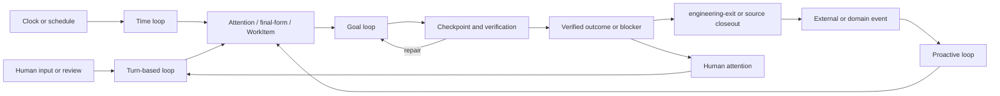

# Agent Loop Topology

## Status

本文定义 ai-meta 个人 AI 系统中四类 loop 的当前架构模型。四类 loop 已有可运行基础，
但成熟度不同：turn-based 和 goal loop 已形成稳定执行入口；time loop 已有独立 automation
实例；proactive loop 已形成 event、domain state、attention 和 WorkItem 基础，但部分跨项目
terminal 回流仍未闭合。

本文描述稳定分层、ownership 和组合规则，不把尚未实现的 supervisor、adapter 或具体业务
workflow 写成当前事实。

## Scope

本文回答：

- turn-based、goal、time 和 proactive loop 各自负责什么。
- 四类 loop 如何组合成一条工作链，而不是演化成四套重复 runtime。
- trigger、execution、attention、source closeout 和 context 分别由谁拥有。
- 新增或修改 loop 时必须保持哪些不变量。

本文不定义具体 scheduler 实现、业务 prompt、MR 状态机、WorkItem schema 或 notification
channel；这些事实由各自项目和 runtime source of truth 维护。

## Topology

四类 loop 不处于同一层：

- **time / proactive** 决定“为什么现在开始”，属于 trigger plane。
- **turn-based / goal** 决定“由谁控制下一轮以及何时停止”，属于 execution plane。



组合链路的稳定形态是：

```text
time / proactive trigger
  -> attention / final-form / WorkItem routing
  -> turn-based or goal execution
  -> verified outcome
  -> source closeout, human attention, or a new domain event
```

Trigger 不直接扩大授权；execution 也不重新发明业务 source of truth。

## Loop Responsibilities

### Turn-Based Loop

Turn-based loop 由人发起下一轮并保留最终判断权，适合需求仍在形成、oracle 较软、需要逐例
纠偏或风险需要人工接受的工作。

边界：

- 用户消息、review feedback 或明确继续指令触发下一轮。
- session 保存短期对话连续性，但不是 durable runtime authority。
- 会改变 scope、acceptance、写入边界或业务判断的反馈必须回写到 `final-form`、loop-ledger contract、
  WorkItem 或对应项目 source of truth，不能只留在聊天历史。
- 当任务已经具备稳定 outcome、checks 和 stop conditions 时，可以编译为 goal loop；不需要
  为了自动化而消除所有人工检查点。

### Goal Loop

Goal loop 针对一个边界明确的 outcome 持续执行、验证和自修复，直到进入可证明的 terminal
state 或遇到必须叫人的 checkpoint。

边界：

- `final-form` 是 sparse work-order contract；`ll.contract.v0` 是嵌入单文件 ledger 的 runtime control contract。
- 每个 run 由当前 session、dispatch、WorkItem 或 handoff 显式绑定 exact loop-ledger file；文件前块供普通轮次读取，后部以 append-only events 保存运行状态和证据；
  不存在全局 active contract，也不得扫描“最新 contract”猜目标。
- contract 拥有 scope、authorization、checkpoints、acceptance evidence、self-repair budget
  和 exit state。
- 当前 runtime adapter 只支持 Codex goal：exact contract 写入并验证后，由显式授权的 `create_goal` 续轮。其他 adapter 值只保留 legacy contract 验证兼容，不代表当前 loop-ledger 可以 dispatch；Symphony、GTD 或 manual runtime 后续需要独立适配。
- pre-prompt hook 可以注入 surface 和 capability 事实，但不能创建 goal、分发 WorkItem 或
  绕过 contract verifier 与用户授权。
- goal loop 只在已授权范围内自修复；scope change、remote write、destructive action、
  acceptance gap 和低置信度业务判断进入 human gate。
- goal loop 的普通工具结果在调用源头保持 2–5K；客户端全局默认值只作为不可重放证据的安全上限。大结果先一次性物化为 exact 临时 artifact，再通过 compact receipt 和定向读取复用；截断不得触发无变化重跑 producer。
- `engineering-exit` 或 source-owned closeout 负责终态交付；`save-context` 只在需要跨 session
  恢复或结束连续工作段时保存恢复索引。

具体垂直生命周期见 [vertical-agent-ll](./vertical-agent-ll.md)，contract 行为以
[loop-ledger skill](../../skills/loop-ledger/SKILL.md)、
[contract verifier](../../scripts/verify-ll-contract) 和
[base fixture](../../scripts/fixtures/ll-contracts/base_ll_contract.json) 为准。

### Time Loop

Time loop 由日历或时钟唤醒工作。scheduler 只拥有 wakeup policy，不拥有业务状态、任务完成
语义或远程写入授权。

边界：

- schedule、timezone、工作日规则和 missed-tick policy 属于 scheduler adapter。
- 业务幂等、目标 identity、checkpoint 和 completion condition 属于被唤醒的 source 或
  goal contract。
- 每次 tick 必须可区分为新工作、同一工作的继续、正常跳过或需要人工介入，不能依赖
  “最近 session / 最近文件”猜测。
- 需要跨 tick 对话连续性时，可以绑定稳定 session id；session continuity 仍不能替代外部
  contract、lease、dedupe state 和 checkpoint evidence。
- time trigger 失败或发现 `needs_human` 时应停止自动推进，并通过 attention 暴露介入原因。

当前 openflow 已通过 Codex Automation 形成可运行 time-loop 实例；Agent Forum 也存在三个
active time triggers。它们证明 scheduler adapter 可运行，但不意味着所有实例都已具备连续
session、统一 supervisor 或完整 terminal 回流。

### Proactive Loop

Proactive loop 由外部事实或 source state 变化触发，先由 domain owner 判断“是否现在需要
agent 或人行动”，再投影为 auto WorkItem 或 attention。

边界：

- producer 只发布事实；不选择业务 handler、execution policy 或 attention priority。
- source domain 拥有 event validation、dedupe、role、state transition、revision freshness
  和 resolution semantics。
- GTD attention 是统一的 `need-me-now` projection，不是 task、MR、WorkItem 或业务完成状态
  的 source of truth。
- delivery channel 只发送结构化 attention，并记录 delivery metadata；不能把 sent/seen
  当作业务完成，也不能从自然语言回复直接执行外部写入。
- 外部推送只承担 wake-up，不复制业务状态或恢复上下文。默认 payload 只包含不透明 attention
  id、通用介入原因和返回受信任 source 的动作；token、内部链接、工单内容、日志和 contract
  不进入推送。增加 Bark、ntfy 等通道只增加触达冗余，不增加状态副本；个人 agent 的敏感
  attention 默认使用自建服务、最小权限和短留存，公共服务只允许无敏感内容的 fallback。
- 自动 WorkItem 完成后必须回到 source domain 做 freshness 和 terminal gate，再决定是否
  产生 human attention。

当前 MR owner feedback 和 blocked reminder 已能进入 GTD attention；viewer 的
agent-first 路径由 GTD ReviewEngagement 直接提交 revision-bound Rollerskate RunIntent，并由
GTD 对 terminal result 做 revision freshness reconcile。其他 proactive source 的通用自动准入和
terminal 回流仍需由各自 owner 单独证明。

## Composition Patterns

### Time To Goal

```text
schedule -> bounded work identity -> goal contract -> verification -> outcome
```

适用于 openflow 这类有稳定时间、幂等目标和硬 completion condition 的操作。scheduler
不应复制业务 dry-run、冲突分类或完成判定。

### Proactive To Goal To Turn

```text
domain event -> GTD ReviewEngagement -> revision-bound RunIntent
  -> Rollerskate Agent Run -> fresh terminal result
  -> attention -> human review
```

适用于 MR reviewer 路径。agent 先处理可自动检查的部分，人只在结果已准备好或需要
业务判断时介入。具体事件链的 source identity、revision freshness 与 reconcile 由 GTD 的
ReviewEngagement 契约判断，Run authority 由 Rollerskate 契约判断；尚未落地的类似链路再由
`final-form` 的 `automation_candidate` 契约判断是否值得做 bounded experiment。

### Turn To Goal To Turn

```text
human framing -> final-form / goal loop -> draft and evidence -> human critique
  -> revised contract or another bounded run
```

适用于 ticket insight、分类规则、agent-facing docs 等软 oracle 工作。人的纠偏必须改变
source behavior 或 acceptance，不能只产生一次性报告修订。

### Trigger Without Execution

time 或 proactive trigger 可以只产生 attention，不必总是启动 agent。高风险、缺少授权、
无法稳定识别目标或需要业务判断时，正确结果是 `needs_human`，不是强行构造 goal loop。

## Source-Of-Truth Map

- 本文拥有四类 loop 的分类、分层和组合不变量。
- [vertical-agent-ll](./vertical-agent-ll.md) 拥有单次 agent 工作从 load、`final-form`、loop-ledger、主 skill、
  `engineering-exit` 到 context 的垂直生命周期。
- [loop-ledger skill](../../skills/loop-ledger/SKILL.md)、
  [contract verifier](../../scripts/verify-ll-contract) 和
  [base fixture](../../scripts/fixtures/ll-contracts/base_ll_contract.json) 拥有 goal-loop 控制契约。
- `~/.codex/automations/` 保存 Codex Automation 本机 schedule/runtime 配置，不是业务规则的
  durable source of truth。
- GTD 的 `docs/architecture/event-driven-ownership.md` 拥有 MR event、ReviewEngagement、revision-bound
  RunIntent、freshness reconcile 和 reviewed state；`docs/architecture/attention-control-plane.md`
  拥有 need-me projection 与 source-side resolution 边界。
- GTD 的 `docs/architecture/workitem-projection.md` 拥有非 MR WorkItem projection、tracker lifecycle、
  resource 和 source closeout；Rollerskate 的
  `docs/architecture/local-review.md` 拥有 Agent Run、Session、workspace authority、执行与 trace。
- `final-form` 的 `references/work-order-contract.md` 拥有 advisory `automation_candidate` 的识别门槛和输出契约；它不授予 Run authority。
- context 只保存恢复 route、当前状态和 next work order；session history 只提供调查证据，
  两者都不替代对应项目的 durable facts。

## Decisions / Invariants

- 四类 loop 复用一组 work-order、runtime contract、attention 和 closeout 边界，不建设四套
  重复 orchestrator。
- time / proactive 是 trigger semantics；turn-based / goal 是 execution-control semantics。
  一个工作流可以同时使用其中多种，而不是四选一。
- trigger 只能唤醒或路由，不能绕过 scope、authorization、human gate 和 source-owned
  transition。
- session id、event id、WorkItem id、revision token 和 contract path 各自表达不同 identity；
  不得用“最新一个”替代显式绑定。
- attention 只回答当前为什么需要人；source resolution 必须回到 source owner。
- 自动执行必须有稳定 stop condition、dedupe identity 和可恢复 evidence；没有这些条件时退回
  turn-based loop 或 `needs_human`。
- delivery failure 不回滚已经成立的业务事实；后续应从 source state 重建 projection 或重试
  delivery。
- `/save-context` 是恢复和交接动作，不是每个 loop turn 或 tick 的默认尾声。

## Risks And Maturity

- **Session continuity masquerading as state**：同一 session 能减少重复定向，但无法替代 contract、
  source state 和并发 lease。
- **Prompt-owned business logic**：把幂等、角色或 completion 全塞进 automation prompt，会让
  scheduler 变成第二套业务实现。
- **Attention as command bus**：把 notification response 直接解释成写操作，会绕过 source
  transition 和确认边界。
- **Duplicate and stale execution**：time tick、至少一次 event delivery 和旧 WorkItem terminal
  result 都可能重复或过期，必须使用 domain identity 和 freshness gate。
- **Premature autonomy**：软 oracle 或业务判断尚未形成稳定 acceptance 时，扩大 goal loop 只会
  隐藏错误；应保留 turn-based gate。

## Change Guidance

新增或修改 loop 时按以下顺序检查：

1. 先判断变化属于 trigger plane 还是 execution plane；不要用新名词复制已有层。
2. 指出业务 source of truth、稳定 identity、dedupe/freshness 规则和真正的 resolution action。
3. 明确输入是 attention、`final-form`、WorkItem 还是 exact loop-ledger contract，以及谁负责把它变为下一层。
4. 明确 human gate、terminal state、source closeout 和结果如何重新进入 attention/event plane。
5. time adapter 覆盖 timezone、missed tick、重叠执行和正常 skip；proactive adapter 覆盖重复
   delivery、乱序、stale revision 和 delivery failure。
6. turn-based feedback 若改变 scope 或 acceptance，必须更新 durable contract；goal loop 若发现
   新结构性工作，退出为 `next_ff_ready`，不隐式扩 scope。
7. 只有端到端验证完成后，才把某条组合链路从 partial 改成 operational；不要从单个脚本、
   文档或 completed contract 推断完整闭环。

## Relationships

- [Architecture index](./index.md)
- [vertical-agent-ll](./vertical-agent-ll.md)
- [Source-of-Truth Boundaries](./source-of-truth-boundaries.md)
- [Project map](../project-map.md)
