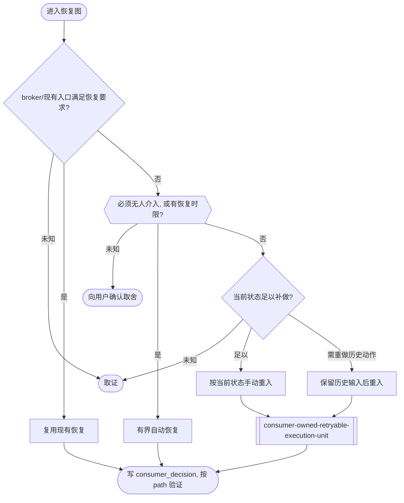

# 消息确认与失败隔离决策图

## Context

新增或改变 consumer 的确认、重试、异常传播、并发或顺序时使用。仅改业务字段不触发。

## Problem

单条消息的可靠性改动，可能拖停共享消费流。确认时点取决于影响范围、丢失后果、顺序依赖和 broker 能力。这些条件有先后：先确定影响范围，再选确认契约。

## Forces

提问顺序即决策图的路径顺序。Q1、Q2、RQ1 是业务偏好，按业务愿意用什么代价换什么收益回答，不按技术上最可靠的方案回答。

- 影响范围（Q0）：共享 topic、consumer 和调用方的原确认时点与失败行为。
- 丢失后果（Q1，偏好）：丢失一次投递后，业务能否接受。事后按当前状态补做也算接受。
- 顺序依赖（Q2，偏好）：后序处理是否依赖本条先完成。
- broker 能力（Q3）：当前 SDK 与消费模式是否支持单条隔离重投。
- 恢复要求（RQ0 至 RQ2）：broker 或现有恢复入口是否满足业务的恢复要求。是否必须无人介入，或有明确恢复时限（RQ1，偏好）。当前状态能否完成补做。

## Pattern

### 走法

1. 从 Q0 走投递图，选出一个 D。如果共享依赖失效，叠加 D5。
2. 走恢复图，选出一个 R。路径到达 R1／R2 时，转入执行单元子图。
3. 写 `consumer_decision`，按 `path` 选择 Verification 条目。

读图约定与业务偏好规则见 [coding-conventions](../SKILL.md) 的「决策图 pattern」。偏好答案中的现有行为，指该 topic 当前的确认契约。

每个业务范围单独走图。一个范围是一个 topic 或一个业务动作。共享消费器上未纳入本次范围的 topic，保持原确认契约。

### 投递图

```mermaid
flowchart TD
    IN([改动确认, 重试, 顺序或异常传播]) --> Q0
    Q0{影响范围已盘点?}
    Q0 -->|否 / 未知| S0([取证])
    Q0 -->|是| Q1{{丢失一次投递, 业务可接受?}}
    Q1 -->|未知| S1([向用户确认取舍])
    Q1 -->|可接受| D1[提前确认]
    Q1 -->|不可接受| Q2{{后序依赖本条先完成?}}
    Q2 -->|未知| S1
    Q2 -->|是| D4[阻塞最小顺序域]
    Q2 -->|否| Q3{SDK/消费模式支持单条隔离重投?}
    Q3 -->|未知| S0
    Q3 -->|支持| D2[成功后确认]
    Q3 -->|不支持| D3[可靠交接后确认]
    D5[共享依赖有界暂停] -. 叠加 .-> D1
    D5 -. 叠加 .-> D2
    D5 -. 叠加 .-> D3
    D5 -. 叠加 .-> D4
    D1 --> NX([进入恢复图])
    D2 --> NX
    D3 --> NX
    D4 --> NX
```



### 恢复图



### 节点说明

路径上各节点的「必须守住」就是本次的不变量。表中风险需要在具体方案中写明接受依据。选中节点本身不构成接受依据。

| 节点 | 动作 | 收益 | 接受的风险／成本 | 必须守住 |
| --- | --- | --- | --- | --- |
| D1 | 提前确认，或失败记录后继续 | 共享流不被单条失败拖停。没有额外状态和重试负载 | 崩溃可能漏执行。补做可能滞后或无法还原历史 | 不宣称逐次可靠交付。失败可发现 |
| D2 | 成功后确认，失败有界重投 | 不丢动作。复用 broker 重投，不新增存储 | 重复、乱序、重试延迟及耗尽 | 无关消息继续。重复副作用受控 |
| D3 | 可靠交接后确认，独立处理 | 不丢动作。原消费位置继续推进 | 交接可能重复。多一份持久状态及积压 | 交接失败不确认。恢复责任有人承接 |
| D4 | 阻塞最小顺序域，恢复或获准终止 | 后序不越过前序 | 域内延迟与积压。毒消息需要处置 | 不静默越过前序。其他域继续 |
| D5 | 共享基础设施失效时，保留确认契约，有界暂停与恢复 | 依赖恢复后继续处理。不放大依赖故障 | 受影响消费整体延迟、积压及恢复压力 | 不丢弃未完成责任。不无限热重试 |
| R0 | 复用 broker 或现有恢复入口。业务无需补做时也走 R0 | 不新增入口、存储或调度 | 沿用既有恢复时限、保留期和操作限制 | 明确耗尽后的责任与结果 |
| R1 | 按动作和业务 ID 手动重入 | 实现小。按对象补做，不需要原消息 | 发现与操作延迟、人力成本。不能还原历史状态 | 鉴权、当前前置条件、幂等和结果读回 |
| R2 | 保留必要历史输入后重入 | 能按历史输入重做指定动作 | 数据保留、版本兼容及过期输入风险 | 不用当前状态冒充历史事实。拒绝已失效动作 |
| R3 | 有界自动恢复 | 不需要人工介入。可以承诺恢复时限 | 调度、持久化、容量与运维成本。依赖故障可能突破时限 | 可发现超时和耗尽。有最终处置 owner |

两张图的组合约束：

- R1／R2 的人工或自动触发方式写入 `reentry.trigger`。
- 人工入口不是可靠交接。路径含 D3 时，先保存可恢复工作，再确认原消息。
- 路径含 D4 时，R1／R2 的补做不越过顺序域。

### 共同约束

- 确认代表释放原投递责任，不一定代表业务成功。
- 业务完成或可靠交接后、确认前崩溃，可能重复处理，必须去重。
- 日志和内存队列不算可靠交接。
- 结果未知时，先查询结果或使用幂等依据。超时不等于未执行。
- 死信不是业务完成。明确恢复 owner，限制重试，保留失败结果。
- 复用已有恢复能力，不默认增加 Inbox、账本或人工 API。

### 节点核对

只读路径经过的节点。

Q3 判断前：

- [ ] Kafka 经典 consumer group 提交的是分区连续进度，不是单条 ACK。回退 offset 重试会阻塞整个分区，不算单条隔离重投。
- [ ] Kafka share group（`KafkaShareConsumer`）支持单条确认与释放。按实际版本和启用状态核对。
- [ ] Kafka 核对自动提交、批次确认、异步完成及 `acknowledge()` 的真实语义。
- [ ] RocketMQ 绑定 SDK、版本与 PushConsumer／SimpleConsumer／旧客户端模式。
- [ ] RocketMQ 按实际模式核对重试、死信和广播行为，不写死通用重试次数。

D2：

- [ ] RocketMQ 并发消费使用支持的隔离重投。
- [ ] RocketMQ SimpleConsumer 核对不可见期、ACK 与有界续期。超时可能并发重投。
- [ ] RocketMQ 批量消费核对成功与重投范围。已成功消息可能重复。

D3。其他路径异步完成 Kafka 记录时，同样适用：

- [ ] Kafka 转入重试 topic 时，交接失败不提交。交接成功后，重复接收可去重。
- [ ] Kafka 低 offset 未完成、高 offset 已完成时，不跨过缺口提交。只越过已完成、已可靠交接或获准跳过的记录。
- [ ] Kafka 重平衡后，禁止旧 worker 提交新 owner 的进度。
- [ ] Kafka 事务不自动覆盖外部数据库或 HTTP。事务消费配置须匹配。

D4：

- [ ] Kafka 暂停必要分区，保持 poll 与组成员存活，其他分区继续。
- [ ] Kafka 分区内按 key 隔离仍受连续 offset 约束，不能靠跳过缺口实现。
- [ ] RocketMQ 顺序消费确认实际阻塞的是队列还是消息组。
- [ ] RocketMQ 需要独立推进的对象，不放入同一必需顺序域。

### 决策记录

这是写入当前设计或评审结果的 YAML 形状，不是运行配置，不新增解析器。`path` 按经过顺序记录节点和答案。路径停在 `S0` 或 `S1` 时，记录到停止节点为止，不替业务接受风险。

`path` 和 `basis` 必填，`basis` 为每个经过的偏好节点写明答案来源。叠加 D5 时写 `overlays`，到达 R1／R2 时写 `reentry`。需要时补 `accepted_risks` 和 `failure_owner`。例子表示业务允许漏掉一次刷新，并允许人工按当前状态补做。

```yaml
consumer_decision:
  scope: profile-refresh
  path: [Q0=是, Q1=可接受, D1, RQ0=否, RQ1=否, RQ2=足以, R1]
  basis: {Q1: "现有行为：失败记录后继续消费", RQ1: "用户确认：接受人工补做延迟"}
  reentry: {action: syncProfile, input: user_id, basis: current_state, trigger: manual}
```

## Failure Modes

| 误判 | 必须保留的边界 |
| --- | --- |
| 先选确认时点，再补盘点影响范围 | 从 Q0 开始。未纳入范围的 topic 保持原契约 |
| 成功后确认总是更正确 | 偏好节点只认用户要求、业务契约或现有行为 |
| 确认时只问“要不要更可靠” | 列出每个分支的收益与代价，给出推荐 |
| 一条失败就重启共享流 | 限制异常传播和资源占用范围 |
| 转入重试队列仍然保序 | 后序越过前序会改变顺序契约 |
| Kafka 可以先提交再补救 | 必须恢复时，先交接责任再提交 |
| 死信入队就是完成 | 只证明隔离，仍需恢复或终止 |
| 选中节点就算接受了风险 | 每项风险需要接受依据 |

## Implementation Checklist

- [ ] 从 Q0 开始走图，记录 `path`。为经过的偏好节点写明 `basis`，为策略节点写明恢复 owner。
- [ ] 对照共享 topic、调用方的改前与改后行为，不顺手改变其他业务。
- [ ] 共享契约确需改变时，先确认业务取舍再实施。
- [ ] 设置适用的重试、超时、并发与积压上限，防止隔离任务耗尽共享资源。
- [ ] Reactor 外层 `retry` 不当作单条重试。核对重试耗尽是否终止订阅。

## Verification

按 `path` 选择条目，不机械执行全矩阵：

- [ ] 所有路径：毒消息持续失败时，无关 topic、分区和业务键仍推进。
- [ ] 所有路径：每个偏好节点的 `basis` 能追溯到用户要求、业务契约或现有行为。
- [ ] D1：失败可观察，后续消息推进，不偷偷升级可靠性。
- [ ] D2／D3：业务完成或交接后、确认前崩溃，恢复时无重复副作用。
- [ ] D2：RocketMQ 批量失败、不可见期超时后的重复符合契约。
- [ ] D3：交接失败不提前推进。Kafka 并发完成与重平衡不跨过缺口。
- [ ] D4：后序不越过前序，其他顺序域不受阻。
- [ ] R1／R2：消费与重入复用同一动作。补做不重发公共 topic，不越过当前权限或顺序约束。

## Evidence And Scope

[Partner 案例](../../../../../_Drafts/2026-10-28-daily-work-review.md)：共享 IT 消费改动使供应商失败拖停离职事件，用户要求恢复原行为。该案例对应 Q0：改动共享消费器前，没有列出其他 topic 的原确认契约。RocketMQ 的另一次案例仅有用户报告，未独立核验。

官方依据：[KafkaConsumer](https://kafka.apache.org/42/javadoc/org/apache/kafka/clients/consumer/KafkaConsumer.html)、[RocketMQ 4.x](https://rocketmq.apache.org/docs/4.x/consumer/02push/)、[重试](https://rocketmq.apache.org/docs/featureBehavior/10consumerretrypolicy/)、[顺序消息](https://rocketmq.apache.org/docs/featureBehavior/03fifomessage/)。实际项目仍需核对版本。
