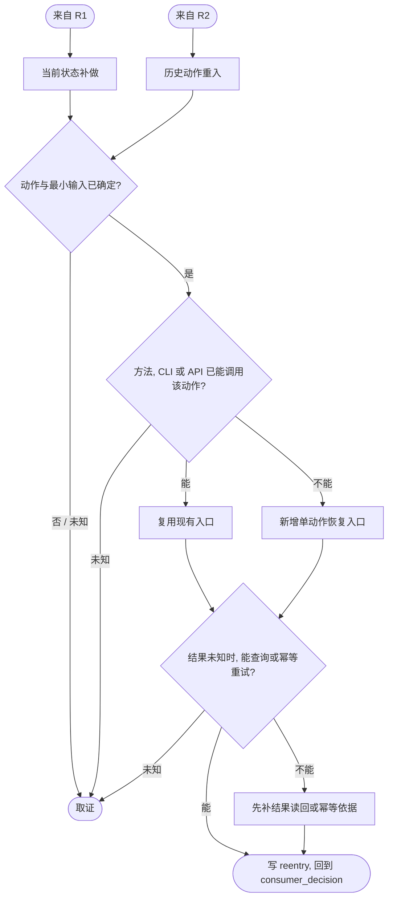

# Consumer 自有的可重试执行单元

## Context

Consumer 业务需要按对象补做、重试或 backfill。先走[消息决策图](consumer-delivery-failure-isolation.md)的恢复图。路径到达 R1 或 R2 时，读取本文件。读图约定与业务偏好规则见 [coding-conventions](../SKILL.md) 的「决策图 pattern」。

## Problem

补做不应被迫寻找消息 envelope 或重发公共 topic。人工可补做也不代表消息已可靠交接。

## Forces

- 补做依据（U1／U2）：恢复图已决定按当前状态补做，或重做历史动作。
- 动作与输入（UQ0）：入口选择哪个内聚动作，完成该动作需要哪些最小输入。
- 入口成本（UQ1）：复用现有方法、CLI 或 API。没有入口时，新增前先问用户。
- 副作用安全（UQ2）：结果未知时，能否查询结果或按幂等依据重试。重复和部分成功后也要能安全再次执行。
- 授权与顺序：重入不越过当前权限、业务前置条件和顺序域。这一项是共同约束，不是分支。

## Pattern

### 节点说明

| 节点 | 动作 | 收益 | 接受的风险／成本 | 必须守住 |
| --- | --- | --- | --- | --- |
| U1 | 入口接受 `action + business_id`，执行时读取当前事实 | 输入最少，不需要原消息 | 历史目标可能已变化。人工恢复有延迟 | 不宣称精确历史重放。必要事实不可得时明确失败 |
| U2 | 增加不可重建的必要输入及版本 | 能重做指定历史动作 | 输入保留与旧版本处理成本 | 缺输入时明确失败，不猜测。拒绝已失效动作 |
| U3 | 通过现有方法、CLI 或 API 调用该动作 | 不新增操作面 | 沿用现有入口的权限和操作限制 | 不重新发布公共 topic |
| U4 | 新增入口，一个入口只选一个内聚动作 | 重复补做时成本低。权限和日志统一 | 操作面、鉴权及维护成本 | 不隐式重跑其他动作或 consumer |
| U5 | 补结果查询或幂等依据，再开放重入 | 结果未知时能安全重试 | 实现与维护成本 | 不把超时当作未执行 |

例如 `syncProfile(user_id)` 读取当前资料，走 U1。指定历史目标时，额外提供必要输入，走 U2。注销发生在源对象删除后时，使用可验证的残留绑定。必要事实已不可得时明确失败。

### 共同约束

- 消费、自动恢复与人工入口调用同一业务动作。
- 执行单元接受业务参数，不依赖 Kafka record 或 listener 实例。
- 人工入口验证当前权限。历史审批不能代替当前授权。
- 重入不跳过当前业务前置条件和顺序约束。
- 结果区分成功、无需处理、失败和结果未知，并关联动作与业务对象。
- 执行单元不改变 ACK 策略，不默认建设 Inbox、账本或调度器。
- 没有现成入口时，先问用户是否值得新建长期入口。一次性补做也调用同一业务动作。
- 所选节点写入同一 `consumer_decision` 的 `reentry`，不另建恢复决策副本。

## Failure Modes

- 只提供 `handle(event)`，补做被迫依赖原消息。
- 复制人工处理逻辑，形成两套行为。
- 当前状态补做冒充历史重放。
- 有重入入口就提前确认，遗漏崩溃后的恢复责任。
- 补做跳过当前权限、业务前置条件或顺序约束。
- 已有入口能调用该动作，仍新增人工 API。
- 未经业务确认，为一次性补做建设长期入口。

## Implementation Checklist

- [ ] 从 R1 或 R2 进入，在 `reentry` 记录动作、输入、依据和触发方式。
- [ ] 一个入口选择一个内聚动作，输入足以完成该动作。
- [ ] 成功、跳过、失败、结果未知均可关联业务对象。
- [ ] 确认业务已接受人工延迟、历史输入成本及并发重入风险。

## Verification

- [ ] 无需无关 envelope 或 offset，指定动作可独立补做。
- [ ] 消费与恢复共用实现，不触发其他 consumer。
- [ ] 重复及部分成功后再执行，结果符合已选契约。
- [ ] U1：源状态变化或源对象删除后，按当前状态语义执行或明确失败。
- [ ] U2：缺少历史输入或动作已失效时，明确失败。
- [ ] 当前权限和顺序保护仍生效，结果可读回。
