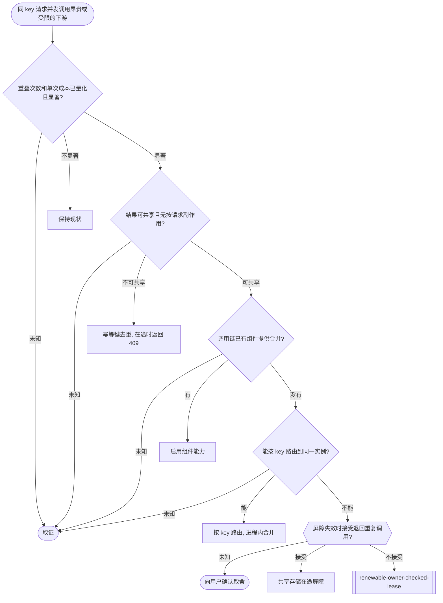

# 同 key 在途请求合并

同一个 key 的请求同时到达，每个都去调一次下游，是惊群（thundering herd）和重复计费的共同形态。在途合并让第一个请求去调下游，其余请求等它的结果。它省的是重复调用，不提供互斥：屏障失效时最坏退回到原来的重复调用，所以只能当效率锁用。不能重复扣款、不能重复发送这类正确性要求，走幂等或租约方案。

## Context

- 缓存未命中回源、第三方校验、token 获取、报表或模型计算等调用，单次成本高，或下游有限流、容量小。
- 同一个 key 的请求会在一次调用耗时内重叠：热点 key 过期、新实例冷启动、调用方重复提交。
- 服务有多个实例，负载均衡不按 key 分配请求。

同 key 重叠很少、单次成本低时，不引入合并机制。key 各不相同的批量加载（例如上线后全量回填）不是本 pattern 的场景，用限并发或预热处理。

## Problem

进程内 single-flight 只覆盖落到同一实例的请求，轮询负载均衡下同 key 的相邻请求大多落到不同实例。共享存储屏障能跨实例，但会把一个外部依赖、一个等待协议和几种超时引入主路径。没有先算清重复量和成本时，这些代价可能远超省下的调用。

## Forces

- **Q1 重复量与成本**：同 key 在一次调用耗时内的重叠次数，乘以单次调用的成本或下游风险（按次计费、限流、容量）。显著指省下的成本或风险超过新增依赖、代码路径和维护的成本。没有统计数字时这个节点是未知。
- **Q2 结果可共享**：同一输入的结果对所有等待者都成立，并且调用没有按请求计的副作用。发短信、扣款、按请求审计的调用不能把一次结果分给多个请求。
- **Q0 已有组件**：调用是否已经经过提供合并能力的组件，例如 nginx `proxy_cache_lock`、CDN 请求折叠、带 lease 的缓存层或缓存库的 loader 合并。
- **Q3 按 key 路由**：调用方或网关能否把同一个 key 的请求稳定送到同一实例，例如一致性哈希或单实例 owner。
- **Q4 失效时的取舍**：屏障依赖故障或等待超时时，是否接受退回重复调用。这是业务偏好。
- **等待预算**：等待时长必须小于调用方超时；持有者的租约 TTL 必须覆盖下游超时。

## Pattern

### 节点说明

| 节点 | 动作 | 收益 | 接受的风险／成本 | 必须守住 |
| --- | --- | --- | --- | --- |
| A0 | 不加合并。重复导致的可识别错误（如唯一键冲突）按“已存在”处理 | 不新增依赖和代码路径 | 重复调用成本照旧；降低日志级别后，日志平台看不到重复量 | 只调整可证明由重复引起的那类错误，其他错误保持原级别 |
| A1 | 用幂等键记录在途请求，同键在途时返回 409，完成后返回首个请求的结果 | 有副作用的操作不重复执行 | 调用方要处理 409 并用同一个键重试 | 冲突时不换新键重试；幂等记录与副作用的提交边界一致 |
| A2 | 打开已有组件的合并配置，设定等待超时和超时后的行为 | 不写新代码 | 受组件语义约束，例如 nginx 等锁超时后放行但不缓存 | 核对所用版本的超时与失败语义 |
| A3 | 网关或调用方按 key 做一致性哈希；服务内用 bean 持有的在途表合并同 key 调用 | 无新外部依赖，等待留在进程内 | 扩缩容和实例故障时 key 迁移，短时间退回重复调用 | 在途表有界，完成或失败立即移除；不用 static 全局状态；单个调用方取消不能取消共享调用 |
| A4 | 按下方步骤用共享存储抢租约、写结果、通知等待者；超过等待预算的请求自己调下游 | 跨实例合并，不依赖路由 | 主路径多一个外部依赖和一段等待；屏障失效时仍会重复调用 | 租约 TTL 覆盖下游超时；等待预算小于调用方超时；共享存储故障时绕过屏障；只缓存确定结果；释放租约校验 owner；key 用规范化输入的哈希，不放明文敏感字段 |
| L1 | 不能接受任何重复调用时，按租约 pattern 加 owner 校验和 fencing，或让下游提供幂等写入 | 守住正确性 | 实现和运维成本更高 | 不把本 pattern 的屏障当正确性保证 |
| S0 | 查调用日志、计费、配置和组件版本，补齐数字后回到原问题 | — | — | 记录统计窗口和来源 |
| S1 | 列出 A4 与 L1 的收益、代价和推荐，等用户决定 | — | — | 决定前保持现状 |

### 共享存储屏障的步骤

1. 读结果键，命中直接返回。
2. 抢租约 `SET lock:<key> <owner> NX PX <ttl>`。抢到的请求调用下游，把确定结果写入带 TTL 的结果键，再发通知，最后用校验 owner 的原子操作释放租约。
3. 没抢到的请求订阅通知或短间隔轮询结果键，等待不超过预算。
4. 等待超时、共享存储不可用或持有者失败时，请求自己调下游，按原逻辑处理结果。这与 nginx `proxy_cache_lock_timeout` 的做法相同：放行，但不写缓存。

Facebook memcache 在缓存服务端用 lease token 实现了同样的协议：每个 key 每 10 秒只发一次 token，其余请求收到稍等通知后重试。Redis 官方的 MemoLock 示例用 `SET NX`、Pub/Sub 和 TTL 实现。

## Failure Modes

- 没有量化重复次数和成本就引入屏障，新增依赖和代码路径的成本超过省下的调用。
- 把屏障当正确性锁：租约过期或共享存储故障后两个请求都调用下游，有副作用的操作被重复执行。
- 租约 TTL 短于下游超时，持有者还在调用时屏障已失效；TTL 过长且持有者崩溃，等待者全部等到超时。
- 等待预算大于调用方超时，合并把一次慢调用放大为一批调用方超时。
- 屏障依赖故障时拒绝请求，把效率优化变成主路径的可用性风险。
- 缓存了临时错误或失败结果，等待者和后续请求都拿到错误。
- 进程内合并用 static 全局表，条目不移除导致泄漏；或某个调用方取消后共享调用被取消，其余等待者也收到取消。
- 轮询负载均衡下只做进程内合并，同 key 请求落到不同实例，合并几乎不生效。
- key 直接使用证件号等明文，敏感字段进入共享存储和日志。

## Implementation Checklist

- 写出 Q1 的数字：统计窗口、同 key 重叠次数、单次成本或限流阈值，以及数据来源。
- 说明结果为什么可共享，列出调用的按请求副作用；没有时写明。
- 先查调用链上已有组件的合并能力，能复用就不新写。
- 选 A3 时，确认路由层能稳定按 key 分配，并说明扩缩容时的退回行为。
- 选 A4 时，写出租约 TTL、等待预算、调用方超时和下游超时四个数，以及共享存储故障时的绕过路径。
- 结果键只存确定结果，TTL 与业务允许的陈旧度一致。
- 为合并命中、等待、超时退回和绕过分别计数，用来证明收益。

## Verification

- A3、A4：同 key 并发 N 个请求，下游只被调用 1 次，所有请求拿到同一结果。
- A3、A4：单个调用方取消不影响其他等待者。
- A4：持有者调用超时或进程被终止，等待者在等待预算内退回自己调用。
- A4：共享存储不可用时，请求绕过屏障并按原逻辑完成。
- A4：下游返回临时错误时不写结果键，下一次请求重新调用。
- A1：在途重复请求收到 409，用同一键重试后拿到首个请求的结果。
- 上线后对比下游调用量或计费，确认省下的调用与 Q1 的估算一致。

## Evidence

- 外部一手材料（2026-11-09 已核对原文）：
  - [Scaling Memcache at Facebook（NSDI 2013）](https://www.usenix.org/system/files/conference/nsdi13/nsdi13-final170_update.pdf)：每个 key 每 10 秒只发一次 lease token，期间其余请求收到稍等通知；数据库峰值查询从 17K/s 降到 1.3K/s。
  - [Redis：Caches, Promises and Locks（2019）](https://redis.io/blog/caches-promises-locks/)：MemoLock 用 TTL、`SET NX` 和 Pub/Sub 跨进程合并，来源是 Instagram 的 [Thundering Herds & Promises](https://instagram-engineering.com/thundering-herds-promises-82191c8af57d)（Instagram 原文未直接读取）；作者指出不会过期的锁在分布式环境里几乎没用。
  - [Discord：How Discord Stores Trillions of Messages（2023）](https://discord.com/blog/how-discord-stores-trillions-of-messages)：数据服务做请求合并，并按 channel ID 做一致性哈希路由，让同 key 请求落到同一实例。
  - [groupcache](https://github.com/golang/groupcache)：整组副本中只有一个进程加载同一个 key，结果分发给所有调用者；按一致性哈希确定 key 的 owner。
  - [nginx proxy_cache_lock](https://nginx.org/en/docs/http/ngx_http_proxy_module.html#proxy_cache_lock)：同一缓存元素只放一个请求回源，其余请求等待；等锁超时后放行但不缓存，`proxy_cache_lock_age` 到期后再放一个。
  - [AWS Builders' Library：Caching challenges and strategies](https://builder.aws.com/content/3K9TeXp6strMiJ4vhakpRD7BQWO/caching-challenges-and-strategies)：对未缓存的资源只保留一个在途请求。
  - [IETF Idempotency-Key 草案](https://datatracker.ietf.org/doc/draft-ietf-httpapi-idempotency-key-header/)：同键请求仍在处理时返回 409。
  - [Kleppmann：How to do distributed locking（2016）](https://martin.kleppmann.com/2016/02/08/how-to-do-distributed-locking.html)：区分效率锁与正确性锁；效率锁偶尔失效只带来少量额外成本。
- 独立命中：Facebook、Instagram / Redis、Discord、groupcache、nginx、AWS 共 6 个独立来源采用同一结构：一个在途调用，等待者共享结果，失效时退回。
- 内部反例：[`idp-kyc-service@bfeca3f`](https://gitlab.example.com/example-org/idp/idp-kyc-service/-/commit/bfeca3f08137843fcd948f02758edf667895280b)。实名校验重复提交在 region-a 7 天 88 次，约每天 13 次，同一证件同一秒最多 3 次。按 Q1 判定不显著，走 A0，只把唯一键冲突降为 INFO。内部尚无采用 A3 或 A4 的正向样本。
- 可迁移性判断：适用于结果可共享、单次调用昂贵或下游受限、同 key 重叠可统计的调用；有按请求副作用的操作和 key 互不相同的批量加载不迁移。

## Relationships

- [以权威存储为提交点的缓存一致性](./authority-first-cache-consistency.md)
- [带 owner 校验与主动续期的分布式租约](./renewable-owner-checked-lease.md)
- [Pattern label](./label.md)
- [coding-conventions](../SKILL.md)
