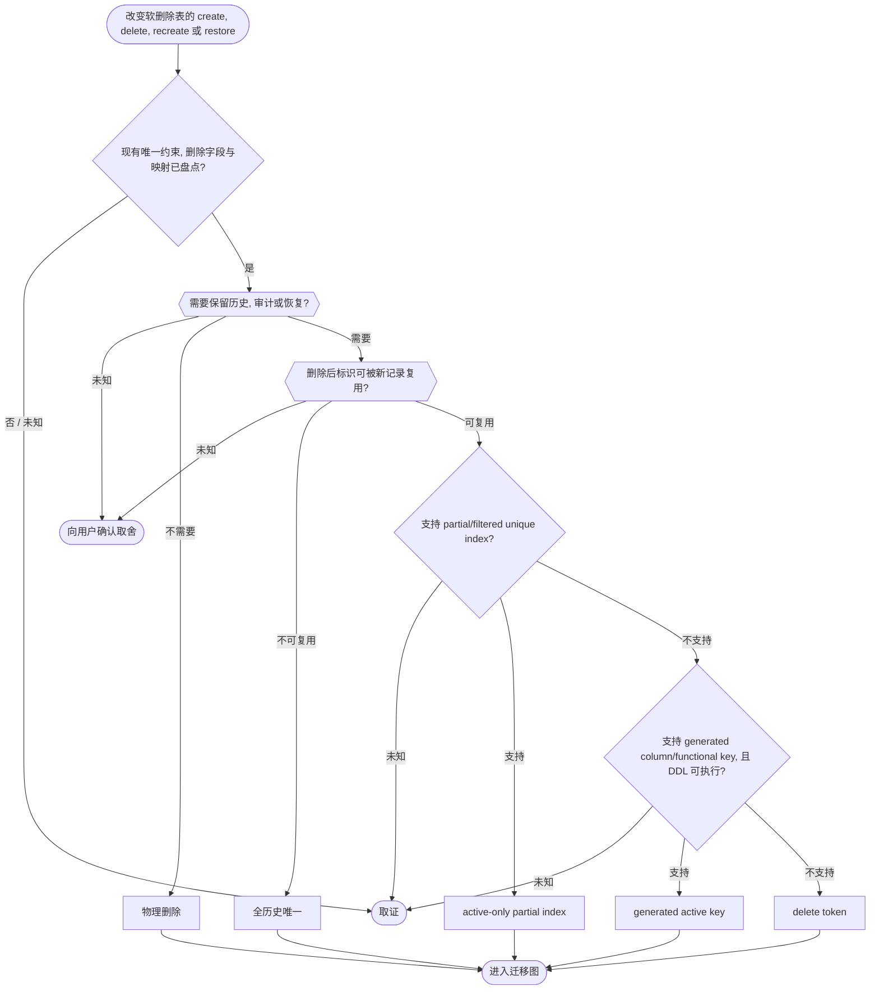
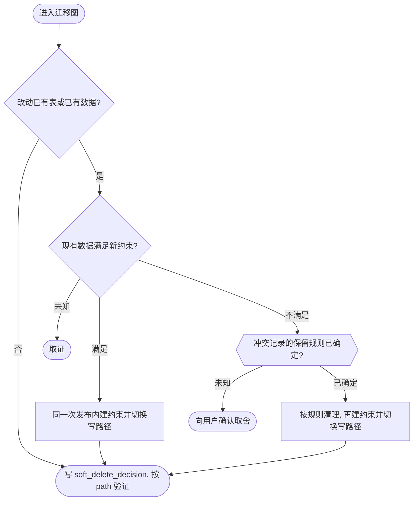

# 面向完整生命周期的软删除唯一性

软删除字段与业务唯一键必须共同表达资源的生命周期。`is_delete = 0/1` 和“删除后写入自身主键”不是代码风格之争：前者适合标识永久保留或数据库能直接约束 active rows 的场景；后者是在缺少 partial unique index 的遗留模型中，让一个业务标识只对应一条有效记录、同时允许保留多条已删除历史记录的 delete token 技巧。

## Context

- 表使用 `is_delete`、`is_deleted` 或 `deleted_at` 保留历史行，普通查询只返回未删除记录。
- 手机号、用户名、外部 identifier、关系组合或其他业务键要求“同一时刻最多一条有效记录”。
- 业务可能执行 create → delete → recreate，也可能 restore 已删除记录。
- 数据库需要在并发 create、delete、rename 和 restore 下继续保护唯一性，应用层预查询不能成为最终约束。
- 既有字段可能名为 `is_delete`，但数据库已经写入主键值，ORM 却仍把它映射为 `Boolean`。

## Problem

软删除只改变查询可见性，不会自动改变数据库唯一性。`UNIQUE(identifier)` 会让已删除行永久占用 identifier；如果应用创建前只查询 `is_delete = 0`，它会判断“可以创建”，随后在数据库插入时撞上历史行。

把索引改成 `UNIQUE(identifier, is_delete)` 也不一定正确。若 `is_delete` 只有 `0/1`，第一次删除产生 `(identifier, 1)`，重新创建产生 `(identifier, 0)`；第二次删除又试图产生相同的 `(identifier, 1)`，因此最多只能保存一条已删除历史。这个错误通常不会在普通 create / delete 测试中出现，而是在完整的 delete → recreate → delete 生命周期才暴露。

反过来，无条件规定“软删除必须把 `is_delete` 写成 id”也会混淆语义。先回答业务偏好和数据库能力，再选字段与索引。

## Forces

提问顺序即决策图的路径顺序。Q1、Q2、MQ2 是业务偏好，不按“软删除惯例”或技术上最通用的方案回答。

- 现状（Q0）：现有唯一索引、删除字段的类型与真实取值、ORM 映射，以及 create 前的预查询条件。
- 历史需求（Q1，偏好）：是否需要保留历史、审计或恢复。不需要时优先物理删除。
- 标识复用（Q2，偏好）：删除后标识是否允许新记录复用。如果业务把删除后重建视为恢复原实体，按不可复用处理，走 restore 原记录。
- 数据库能力（Q3、Q4）：partial / filtered unique index、generated column、functional key part，以及在线 DDL 能力。
- 现有数据（MQ1）：active 重复、规范化差异、`NULL` 和 Boolean `1` 历史行是否违反新约束。
- 冲突保留规则（MQ2，偏好）：现有数据冲突时保留哪条记录、其余如何处理。

## Pattern

### 走法

1. 从 Q0 走选型图，选出一个 P。
2. 改动已有表或已有数据时，走迁移图。
3. 写 `soft_delete_decision`，按 `path` 选择 Verification 条目。

读图约定与业务偏好规则见 [coding-conventions](../SKILL.md) 的「决策图 pattern」。偏好答案中的现有行为，指该表当前的唯一约束与删除语义。每个业务键单独走图。

### 选型图



### 迁移图



### 节点说明

| 节点 | 动作 | 收益 | 接受的风险／成本 | 必须守住 |
| --- | --- | --- | --- | --- |
| P0 | 物理删除行，不保留软删除状态 | 唯一约束直接成立，没有生命周期状态 | 无法审计或恢复 | 关联、缓存与下游投影同步删除或失效 |
| P1 | `UNIQUE(identifier)` 覆盖全部历史行，`is_deleted` 或 `deleted_at` 只表达可见性 | 结构最简单。标识永远不被其他记录占用 | 删除后不能用同一标识新建 | create 冲突检查包含已删除记录，返回稳定的“标识已占用”。重新启用只走 restore 原记录，并重新验证业务状态和权限 |
| P2 | 只对有效行建立 partial unique index | 字段语义真实，可以保留任意多条历史 | 依赖数据库的 partial index 能力 | 应用的 active predicate 与索引谓词一致。不用 `UNIQUE(identifier, deleted_at)` 代替 |
| P3 | generated column 把已删除行映射为 `NULL`，再建立 unique index | MySQL 也能只约束有效行，字段语义真实 | 版本、索引长度、字符集、collation 与 generated column 限制 | 按实际数据库版本验证 DDL，不照抄示例 |
| P4 | `delete_token BIGINT`：`0` 表示有效，行主键表示已删除，`UNIQUE(identifier, delete_token)` | 不依赖新的索引能力，也能保留多条历史 | 字段不再是 Boolean，映射、序列化和查询都要改 | token 使用稳定、非零、能无损写入的主键。不用时间戳或随机值。`deleted_at`、`deleted_by` 独立存在 |
| M0 | 在同一次发布内建立新约束并切换写路径 | 无需清理数据 | 大表 DDL 的锁表与发布窗口 | 不先删旧索引。约束与写路径之间不留无保护窗口 |
| M1 | 按已确定的规则合并或标记冲突数据，再建约束并切换写路径 | 新约束一次成立 | 回填、对账与迁移窗口成本 | 无法识别的冲突保持原值并交给业务处理。不在不同发布中先改字段含义再补约束 |

### 节点核对

P2：

```sql
CREATE UNIQUE INDEX uniq_active_identifier
    ON resource (normalized_identifier)
    WHERE deleted_at IS NULL;
```

- [ ] 不建立 `UNIQUE(identifier, deleted_at)` 并把有效行的 `deleted_at` 设为 `NULL`。允许多个 `NULL` 的数据库会因此允许多条有效行。

P3：

```sql
ALTER TABLE resource
    ADD COLUMN active_identifier VARCHAR(128)
        GENERATED ALWAYS AS (
            CASE WHEN is_deleted = 0 THEN normalized_identifier ELSE NULL END
        ) STORED,
    ADD UNIQUE INDEX uniq_active_identifier (active_identifier);
```

- [ ] 复合业务键可以生成 active key，或增加 `active_marker = CASE WHEN is_deleted = 0 THEN 0 ELSE NULL END` 并建立 `UNIQUE(key_part_1, key_part_2, active_marker)`。

P4：

```sql
delete_token BIGINT NOT NULL DEFAULT 0,
UNIQUE KEY uniq_identifier_lifecycle (normalized_identifier, delete_token)

UPDATE resource
SET delete_token = id,
    deleted_at = CURRENT_TIMESTAMP
WHERE id = ?
  AND delete_token = 0;
```

- [ ] 新模型优先命名为 `delete_token` 或 `deleted_record_id`。遗留 schema 必须继续叫 `is_delete` 时，数据库类型、领域模型、序列化和 repository mapping 都使用整数，并注释 `0 = active, id = deleted`。

M1（从 Boolean `0/1` 迁移到 delete token 时）：

1. 扫描 active duplicates、历史冲突、`NULL`、大小写和规范化差异。
2. 引入能容纳主键的 `BIGINT` token 或 generated active key，不复用 `TINYINT(1)`。
3. 将所有 deleted rows 从 `1` 回填为各自行主键，active rows 保持 `0`。校验 token 唯一且无截断。
4. 同步修改 entity、DTO 和 repository mapping，删除 `Boolean` 假设和 `= 1` 查询。
5. 在数据满足约束后建立新 unique index，再切换 create、delete、restore 和 rename 写路径。
6. 用 schema introspection、行数对账和完整生命周期测试验证后，才移除旧索引或旧字段。

### 共同约束

数据库唯一约束是并发终态 oracle：

- 应用层 `exists` 或 `findActive` 只用于提前返回友好错误，不能证明随后的 insert 安全。
- 写前使用与索引完全相同的规范化、字符集和 collation 语义。
- 捕获目标 constraint 的 duplicate-key error，映射为稳定业务冲突。不把所有数据库异常都改写成“已存在”。
- 并发 create 只允许一个提交成功。失败方不通过先删后插、覆盖写或无界重试绕过唯一性。
- delete 和 restore 使用条件更新与 rows-affected 判断实现幂等。

create、delete、recreate 与 restore 使用同一状态机：

- **Create**：规范化 business key 后直接插入 active row；duplicate key 映射为稳定冲突。
- **Delete**：只把当前 active row 转成 deleted；重复删除按 API 契约返回幂等成功或稳定 not-found，不再次改写 token。
- **Recreate**：创建新的主键和 active token；旧历史保持 deleted，不被覆盖或复用。
- **Restore**：尝试把目标历史行恢复为 active；identifier 已被新 active row 占用时，由唯一约束拒绝并进入显式冲突处理，不覆盖后来记录。
- **Rename**：在 active-only 唯一约束下更新规范化 identifier；与 create 使用同一 duplicate-key 语义。
- **Hard purge**：只按独立保留策略清理 deleted rows，不承担释放 active identifier 的正确性。

查询、缓存和下游投影遵循相同状态语义：

- 普通 repository 默认显式限制 active predicate；管理和审计查询通过独立方法包含 deleted rows。
- 缓存 key 与失效 scope 覆盖 create、delete、recreate、restore 和 rename；deleted old row 不能在新 active row 创建后重新填回缓存。
- CDC 或 event 包含 record id、business key、前后 lifecycle state 和版本，使下游能区分 delete、recreate 与 restore。
- 关联表不会因为主表软删除自动级联；单独声明关联保留、隐藏、解绑或清理语义。
- 所有 active-only 查询与唯一索引使用相同的 normalized key 和 active predicate，并用 `EXPLAIN` 验证主路径能利用索引。

### 决策记录

这是写入当前设计或评审结果的 YAML 形状，不是运行配置。例子表示业务要求保留审计历史，并允许删除后用同一手机号重新注册。

```yaml
soft_delete_decision:
  scope: user.phone
  path: [Q0=是, Q1=需要, Q2=可复用, Q3=不支持, Q4=支持, P3, MQ0=是, MQ1=满足, M0]
  basis: {Q1: "业务契约：账号删除记录保留 180 天供审计", Q2: "用户确认：注销后手机号可重新注册"}
```

## Failure Modes

- 按惯例直接选 delete token，没有先回答 Q1、Q2。
- 把“软删除”直接等同于 `is_delete BOOLEAN`，没有定义业务标识删除后是否释放。
- `UNIQUE(identifier)` 约束全部历史行，但 create 只检查 active row，导致业务预检与数据库事实冲突。
- 使用 `UNIQUE(identifier, is_delete)` 加 `0/1`，只测试一次 delete / recreate，没有发现第二次 delete 会与第一条历史冲突。
- 数据库把 `is_delete` 写成主键，Java / ORM 仍映射为 Boolean，读取、序列化或条件查询把所有非零值压成同一状态。
- 仅用应用层 `SELECT` 检查唯一性，并发 create 或 restore 产生双 active rows。
- restore 无视后来创建的 active row，覆盖新实体或篡改 identity continuity。
- 迁移时把全部历史 `is_delete = 1` 原样转成 `BIGINT 1`，复合唯一键仍然只能容纳一条 deleted history。
- 先删除旧唯一索引再清理数据和建立新约束，留下并发写入多个 active rows 的无保护窗口。
- 默认认为软删除会级联到关联、缓存和搜索投影，导致旧关系或旧对象在下游继续可见。

## Implementation Checklist

- [ ] 从 Q0 开始走图，写出 `path`，并为每个偏好节点写明 `basis`。
- [ ] 规范化、字符集、collation、`NULL` 与大小写语义在应用检查和数据库索引中一致。
- [ ] create、delete、recreate、restore、rename 和 hard purge 都有显式状态与冲突语义。
- [ ] repository active predicate、缓存失效、CDC 和下游投影共享同一 lifecycle state。
- [ ] 大表按数据库在线 DDL 能力制定发布、锁表、回滚和批量 backfill 方案。

## Verification

按 `path` 选择条目：

- [ ] P1：删除后用同一标识 create，返回稳定的“标识已占用”；restore 原记录后状态与权限重新验证。
- [ ] P2／P3／P4：执行 create → delete → recreate → delete → recreate，始终最多一个 active row，且可保留多条 deleted history。
- [ ] P2／P3／P4：identifier 已被新记录占用时 restore 旧记录，唯一约束拒绝并进入显式冲突处理。
- [ ] P4：重复 delete 同一记录，token 不被再次改写，API 幂等语义稳定。
- [ ] 所有路径：并发创建相同 normalized identifier，仅一个事务成功，其他请求返回目标 constraint 对应的稳定业务冲突。
- [ ] 所有路径：大小写、空白、区号、Unicode normalization 等规范化边界下，应用与索引看到同一 key。
- [ ] 所有路径：回读 schema，字段类型、default、generated expression、index columns 与 active predicate 符合设计；active lookup 和 create conflict probe 的 `EXPLAIN` 使用索引。
- [ ] M0／M1：迁移 fixture 包含多条 `is_delete = 1` 历史、active duplicate、`NULL` 和最大主键，backfill 无冲突、无截断、无漏行。
- [ ] 所有路径：重放 delete 前的缓存填充或下游事件，旧版本不能覆盖 recreate 或 restore 后的新 active 状态。

## Evidence

- 真实命中：[`example-device-service!68`](https://gitlab.example.com/example-org/iam/example-device-service/-/merge_requests/68) 新增 identifier 唯一键时仍使用 `TINYINT(1)` / Boolean 软删除；active-only 预查询与历史行唯一约束不一致，完整 delete → recreate 生命周期需要在“永久占用”与“active-only unique”之间明确选择。
- 真实命中：[`example-partner-service@227642d` schema](https://gitlab.example.com/example-org/idp/example-partner-service/-/blob/227642de495ba113a34e60f6ea97d9606b40551d/sql/00_schema.sql#L26-41) 使用 `BIGINT is_delete` 和多组 `UNIQUE(business_key, is_delete)`，[删除实现](https://gitlab.example.com/example-org/idp/example-partner-service/-/blob/227642de495ba113a34e60f6ea97d9606b40551d/src/main/java/com/example/iam/partner/repository/impl/UserRepositoryImpl.java#L363-372) 将 token 写为行主键，独立证明该结构可同时保留历史与释放 active business key。
- 独立复现次数：2 个服务仓库分别提供失败命中与既有实现，并共同覆盖唯一索引、字段类型、删除写路径和重复生命周期。
- 可迁移性判断：该模式适用于需要软删除且存在 business uniqueness 的关系数据库表；无唯一业务键、物理删除或数据库已由其他 authority 管理生命周期时不迁移。identifier 永久保留时走 P1，不迁移到 active-only index 或 delete token。

## References

- [MySQL CREATE INDEX Statement](https://dev.mysql.com/doc/refman/8.4/en/create-index.html)：说明 unique index 的复合 key 与多个 `NULL` 值语义。
- [MySQL Optimizer Use of Generated Column Indexes](https://dev.mysql.com/doc/refman/8.4/en/generated-column-index-optimizations.html)：说明 generated column 可建立并使用索引。
- [PostgreSQL Partial Indexes](https://www.postgresql.org/docs/current/indexes-partial.html)：说明通过 predicate 建立 partial unique index，只约束满足条件的 rows。

## Relationships

- [基于主键扫描的破坏性清理](./primary-key-sweep-for-destructive-cleanup.md)
- [按操作定义一致性与分区契约](./operation-scoped-consistency-contract.md)
- [Pattern label](./label.md)
- [coding-conventions](../SKILL.md)
